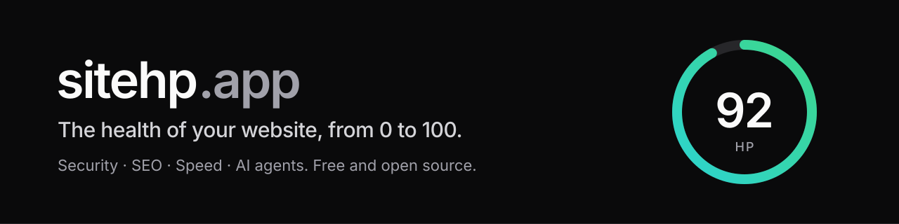

# sitehp.app



**A website health check, free and open source.** Enter a URL and get an HP score (health points, from 0 to 100, like in a game) and a ranked list of what to fix first, in plain language: security, SEO, speed and readiness for AI agents, checked from the outside in a few seconds.

[](https://github.com/janszotkowski/sitehp.app/actions/workflows/ci.yml)
[](LICENSE)

sitehp.app fetches a site the way a visitor, a search engine and an AI crawler do, runs 57 small, independent checks on what comes back, and scores the result. It needs no account, no paid API and no access to the site, and runs on a single small server.

## ✨ Features

- **57 checks in four areas**: HTTPS and certificates, security headers, cookies and mixed content; page basics, indexing, site files and social sharing; server and page speed; and how well AI agents can read and discover the site.
- **One number that means something**: every lost point has a check, a reason and the evidence behind it, and a failed critical check holds the score down. [How the score works](docs/CHECKS.md#how-the-score-works).
- **A ranked list of fixes**: ordered by how many HP each fix brings back, with the effort it takes and a plain explanation of why it matters.
- **Live**: the report fills in check by check as the scan runs (Server-Sent Events), and any number of people can watch the same scan.
- **Take it with you**: a shareable report link, a share image, an HP badge for a README, a print and PDF version, and JSON or Markdown exports.
- **Safe by design**: passive checks only, every address re-validated against private networks on every redirect, rate limits per caller and per domain.
- **Accessible and bilingual**: built to WCAG 2.2 AA, keyboard and screen reader friendly, light and dark themes, in English and Czech.

The complete list is in [docs/FEATURES.md](docs/FEATURES.md).

## 🚀 Quick start

You need Node 24.22.3 and pnpm 12.

```bash
git clone https://github.com/janszotkowski/sitehp.app.git
cd sitehp.app
pnpm install
pnpm env:init
pnpm dev
```

The web app runs at http://localhost:3000/en and the API at http://localhost:4000/v1/health. `pnpm dev` needs no database, Redis or Docker: scans are kept in memory. See [docs/DEVELOPMENT.md](docs/DEVELOPMENT.md) for the details, the full production-like stack in Docker, and every command.

## 📖 Use it

- **Website**: enter a URL on the landing page and watch the report fill in. No account.
- **REST API**: start a scan, read a report and follow a scan live. Reference in [docs/API.md](docs/API.md).

    ```bash
    curl -X POST http://localhost:4000/v1/scans -H 'content-type: application/json' -d '{"url":"example.com"}'
    ```

- **Badge**: `/badge/r/<report id>.svg` shows a report's HP, for a README or a status page.
- **Markdown**: every public page has a `.md` twin for AI agents, and a report exports as Markdown or JSON.

## 📚 Documentation

- [Features](docs/FEATURES.md): everything the site offers.
- [Checks and scoring](docs/CHECKS.md): every check, its severity, and how the HP score is calculated.
- [API reference](docs/API.md): the endpoints, the scan events and the error codes.
- [Architecture](docs/ARCHITECTURE.md): the scan engine, the backend, the frontend, security and privacy.
- [Configuration](docs/CONFIGURATION.md): every environment variable, and running it with Docker Compose.
- [Development](docs/DEVELOPMENT.md): local setup, repository layout, commands and code style.
- [Design language](docs/DESIGN.md): color, type, motion and voice of the interface.
- [Changelog](docs/CHANGELOG.md): notable changes.

## 🤝 Contributing

Contributions are welcome: bug reports, wrong results, new checks, translations. Please read [CONTRIBUTING.md](CONTRIBUTING.md) first; everyone taking part follows the [Code of Conduct](CODE_OF_CONDUCT.md). Open an issue for a [bug](https://github.com/janszotkowski/sitehp.app/issues/new?template=bug_report.yml), a [wrong result](https://github.com/janszotkowski/sitehp.app/issues/new?template=wrong_result.yml), or a [feature request](https://github.com/janszotkowski/sitehp.app/issues/new?template=feature_request.yml).

To report a security problem in sitehp.app itself, follow the private reporting process in [SECURITY.md](SECURITY.md).

## 📄 License

[MIT](LICENSE) © Jan Szotkowski. A report describes what a site answered at the moment it was scanned, without warranty of any kind: it is a starting point for a fix, not a security audit or a guarantee.

Created and maintained by [Jan Szotkowski](https://github.com/janszotkowski) ([@janszotkowskix on X](https://x.com/janszotkowskix)). See the [contributor graph](https://github.com/janszotkowski/sitehp.app/graphs/contributors) for everyone who has helped improve sitehp.app.
